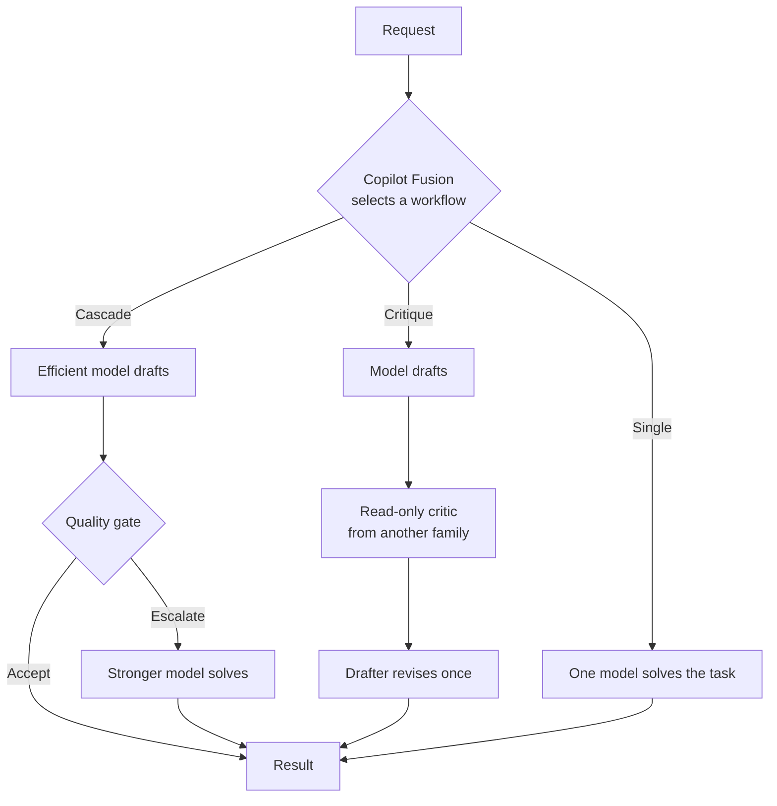

There are two loud opinions about coding agents right now.

One says frontier models make harnesses irrelevant. Give the smartest model a terminal and a repository, and the scaffolding around it is just a thin wrapper that will disappear with the next model release.

The other says the harness matters more than the model. A good harness with an average model will outperform a great model in a poor harness, because the harness decides what the model sees, which tools it can use, and how its work is verified.

Both opinions contain some truth, but both blur two different components. To understand which one matters for a given task, we need to be precise about what each one actually does.

## What a Model Is

A large language model (LLM) is a function. It receives a sequence of tokens and produces a sequence of tokens. Everything it "knows" about your task must be in that input: the system prompt, the conversation, the tool definitions, the file contents, the test output.

The model does not read your repository. It does not run your tests. It does not remember yesterday's session. It only sees the context it is given, on every single call.

That sounds limiting, but what models do with that context has changed dramatically:

1. **Next-token prediction.** Early models continued text. Useful for autocomplete, unreliable for anything that required several steps.
2. **Instruction following.** Models learned to follow a request instead of merely continuing it.
3. **Tool calling.** Models learned to emit structured requests such as "read this file" or "run this command", and to use the result in the next step.
4. **Planning and reasoning.** Current models decompose a problem, produce a plan, and spend "thinking" tokens working through it before answering. They can notice a failed approach and revise it.

The model's responsibilities are therefore:

- Understanding the intent of the request.
- Reasoning about the problem and planning the steps.
- Deciding which tool to call next, and with which arguments.
- Generating code, tests, explanations, and reviews.
- Judging whether a result satisfies the request.

All of that is billed in tokens. Every input token is read, every reasoning token is generated, every output token is generated.

## What a Harness Is

The harness is everything around the model. GitHub Copilot CLI, Copilot in VS Code, Claude Code, and Codex CLI are all harnesses. They are the runtime that turns a stateless text function into an agent that can work on a repository.

Harnesses have also evolved:

1. **Context collection.** The first harnesses gathered the current file, the selection, and maybe a few open tabs, and sent them with the prompt.
2. **The agent loop.** The harness executes the model's tool calls, appends the results to the conversation, and calls the model again until the task is done.
3. **Context management.** Instructions, skills, and MCP servers are loaded on demand. Long conversations are compacted. Large outputs are saved to files instead of flooding the context, as described in [Reducing Token Usage in Code Agents](/posts/Reducing-Token-Usage-in-Code-Agents/).
4. **Subagents.** The harness starts new agents with their own clean context, focused on a narrower task, possibly with a different model and a restricted set of tools.

The harness's responsibilities are therefore:

- Building the context for each model call.
- Executing tools: file system, shell, search, MCP servers.
- Enforcing permissions and sandboxing.
- Managing sessions, compaction, and memory.
- Running hooks, the deterministic checks covered in [The Architecture of Code Agents](/posts/The-Architecture-of-Code-Agents-Instructions-Skills-Agents-Hooks/).
- Starting subagents and choosing the model for each one.

## Where They Overlap

These evolutions created an overlap. Models now plan, and harnesses now orchestrate. Both can decompose a task. Both can decide that a step needs review.

A frontier model can plan a refactoring, work through it step by step, and check its own work, all within one long conversation. A harness can achieve something similar by splitting the same refactoring into a planner, an implementer, and a reviewer, each running in a separate context.

That overlap is why the debate exists. But the overlap is in *what* gets done, not *how* it is paid for. And that difference matters a lot.

## Harness Operations Are Free

When the harness reads a file, runs a grep, executes the tests, applies a patch, or checks a permission, it uses no tokens. It is ordinary code running on your machine or in a container. It is deterministic, fast, and does not hallucinate.

The model pays for every step of reasoning. The harness pays nothing for its mechanics.

This has a practical consequence: anything that can be done deterministically should be done by the harness, not reasoned about by the model. A hook that runs the formatter costs nothing. Asking the model to check the formatting costs tokens and may still be wrong.

There is an important nuance. The *decision* to delegate is often made by a model. When a parent agent decides to spawn a subagent, that decision is reasoning, and it is billed. What is free is everything the harness does without asking a model.

## The Harness Chooses the Model

The most important thing a harness can do with subagents is pick the right model for each one.

Not every step of a coding task needs frontier reasoning:

- Searching the code base for callers of a method.
- Running a test suite and summarizing the failures.
- Comparing a build output against a baseline.
- Formatting a commit message.

A small, cheap model handles these well. Frontier models are better reserved for planning, difficult implementation, and adversarial review.

In Copilot, a custom agent declares its model in its frontmatter:

```yaml
---
name: quality-gate
description: Runs the build and tests and compares the results with the baseline.
model: gpt-5.4-mini
tools: ["bash", "view"]
---
```

This is exactly what I did in the squad described in [Building Reliable Coding-Agent Squads](/posts/Building-Reliable-Coding-Agent-Squads/). The planner uses a strong reasoning model. The quality gate uses an economical model, because its job is running prescribed commands and applying a fixed rule.

## But Every Model Change Costs Context

Choosing a different model is not free either. Models do not share state. When the harness hands a task to a different model, that model receives its full context as fresh input.

As explained in [Prompt Caching for Coding Agents](/posts/Prompt-Caching-for-Coding-Agents/), providers cache the prompt prefix of previous requests. A cached input token costs a fraction of an uncached one. But caches are per model and per provider. Switching models means a cold start: the system prompt, tool definitions, instructions, and task context are all processed again at full price.

This is the hidden cost of multi-model orchestration. A cheap model with a cold cache can cost more than an expensive model with a warm one, especially when the shared context is large.

## Frontier Models: Expensive but Consistent

A single frontier model has the opposite profile.

It is expensive per token, and it charges the same rate whether the step is "list the files in this folder" or "find the race condition in this scheduler". A simple operation does not become cheaper because it is simple.

On the other hand, a single model working through one long conversation makes the best possible use of the cache. Each turn appends to the same prefix. Most of the input is cached. The model also keeps the full reasoning history, so nothing is lost in a handoff between agents.

So we have two strategies with different costs:

| | Single frontier model | Harness-orchestrated models |
|---|---|---|
| Cost per token | High | Varies per step |
| Simple operations | Same price as complex ones | Routed to cheap models |
| Prompt cache | Stays warm in one conversation | Cold start on each model change |
| Context | One growing context | Clean, focused contexts per task |
| Handoffs | None | Summaries can lose information |
| Independent review | Self-review by the same model | Review by a different model family |

Neither column wins in general. The best strategy depends on the task: how much of it is simple, how large the shared context is, and how much an independent review is worth.

That is the real answer to the debate. Frontier models do not make harnesses irrelevant, because the harness decides when the frontier is worth paying for. And the harness is not more important than the model, because no orchestration rescues a model that cannot solve the hard step.

The interesting question is who makes that choice, and when.

## Copilot Fusion: Orchestration as a Model

GitHub introduced [Project HydraFusion](https://github.blog/ai-and-ml/github-copilot/project-hydrafusion-frontier-quality-via-multi-model-orchestration/) as a research preview in GitHub Copilot CLI. It has since been renamed **GitHub Copilot Fusion**, as described in the [VS Code 1.144 release notes](https://code.visualstudio.com/updates/v1_144#_models). It answers that question at runtime.

You select Copilot Fusion like any other model. Behind that single choice, it is not one model. For each request, it builds an execution plan across models from multiple providers, balancing quality, cost, and latency.

It currently chooses one of three execution patterns:

- **Single.** One selected model solves the task directly.
- **Cascade.** An efficient model drafts a solution, and a quality gate decides whether to accept it or escalate to a stronger model.
- **Critique.** One model drafts a result, an independent read-only critic from a different model family reviews it, and the drafting model revises once.



The key word in the announcement is *selectivity*. Copilot Fusion picks the least complex workflow it expects to meet the quality bar. It uses additional model calls only when they are likely to improve the result. That is precisely the trade-off from the previous section, made per request instead of per configuration.

The published offline results are worth reading with their caveats:

| Benchmark | Cost vs. Claude Opus 5 | Quality vs. Claude Opus 5 |
|---|---|---|
| TerminalBench 2.1 | 67% lower | +4.9 points |
| DeepSWE | 36% lower | -1.5 points |
| CheckpointBench | 65% lower | -0.1 points |

Near-frontier quality at a fraction of the cost. GitHub also notes that these numbers are specific to the evaluated benchmarks, model pool, and pricing assumptions, and that caching efficiency is one of the things the preview will validate on real workloads. That is consistent with the cache trade-off above: multi-model workflows have to earn back their cold starts.

The engineering principles are also familiar to anyone who has built a squad:

- **Complete accounting** across every leg: draft, critique, revision, escalation, retry, fallback.
- **Bounded execution**, with timeouts and cancellation per leg.
- **Isolated review**, with critics running in tool-less contexts so they cannot modify the repository.
- **Fail-safe application**: no patch is applied if the workflow fails or is cancelled.

## Trying Copilot Fusion in Copilot CLI

The original CLI research preview required experimental features to be enabled first. Inside a Copilot CLI session, run these commands one at a time:

```text
/update
/experimental on
/model
```

1. `/update` makes sure the CLI is on a version that includes the preview.
2. `/experimental on` enables experimental features. The CLI may restart.
3. `/model` opens the model picker, where you select **Copilot Fusion**. Older preview versions may still use the **HydraFusion (Research Preview)** name.

If the entry is missing, check that the update completed and that experimental mode is on. Preview names and availability can change.

While a request runs, the CLI shows which workflow was selected and its progress. Stephen W. Thomas walks through this in his [HydraFusion guide](https://www.stephenwthomas.com/artificial-intelligence/hydrafusion-github-copilot-cli/): a trivial `add two plus two` was routed to **Single**, while a more involved prompt was routed to **Cascade**, with main, review, and conditional fix-up passes. That is the selectivity in action: the simple request did not pay for a review it did not need.

## Copilot Fusion and Agent Squads

In [Building Reliable Coding-Agent Squads](/posts/Building-Reliable-Coding-Agent-Squads/), I described a squad where the model of each agent is chosen by role, a deterministic gate decides whether work can move forward, and an independent reviewer cannot edit the code it critiques.

Copilot Fusion performs a similar job automatically:

- **Cascade** is model routing with a quality gate: try the cheap model first, escalate only when needed.
- **Critique** is the adversarial reviewer from a different model family, without write access.
- **Single** acknowledges that sometimes the best squad is a squad of one.

The difference is who designs the workflow.

A hand-authored squad is a fixed, versioned graph. Its roles, models, tools, handoffs, repair limits, and publication criteria live in the repository. It encodes project-specific knowledge: run these tests first, compare against this baseline, never publish without this approval. That is what makes it repeatable and auditable, and also what makes it [substantial work to author](/posts/Building-Reliable-Coding-Agent-Squads/#the-manual-authoring-cost).

Copilot Fusion requires no authoring. It decides the workflow per request, from general capability signals, and its model pool improves as GitHub adds new models. What it does not know is your project's definition of done.

They are not mutually exclusive. A custom agent declares a model, and that model can be Copilot Fusion. A squad can keep its fixed outer workflow and its deterministic gates, while the individual specialists let Copilot Fusion decide how to solve their bounded tasks.

GitHub recommends starting with substantial, well-scoped, single-prompt tasks in autopilot mode, as multi-turn performance is the next focus of the preview. That is also a good way to compare it with your current setup: give the same task to your usual frontier model, to Copilot Fusion, and to your squad, and compare quality, cost, and the number of corrections you had to make.

## Conclusion

The model and the harness are not competing for the same job.

The model reasons. It plans, writes, and judges, and every token of that work is billed. The harness executes. It builds the context, runs the tools, enforces the rules, and decides which model gets which task, without spending a token on its own mechanics.

Frontier models raised the ceiling of what a single call can do. Harnesses raised the floor of what a workflow can guarantee. The trade-off between them is cost per token versus cache reuse, one rich context versus several clean ones, self-review versus independent review.

Copilot Fusion is interesting because it moves that trade-off out of the developer's hands and into the runtime. You no longer choose between the best model and the best harness. You choose a runtime that decides, for each task, how much model it actually needs.
